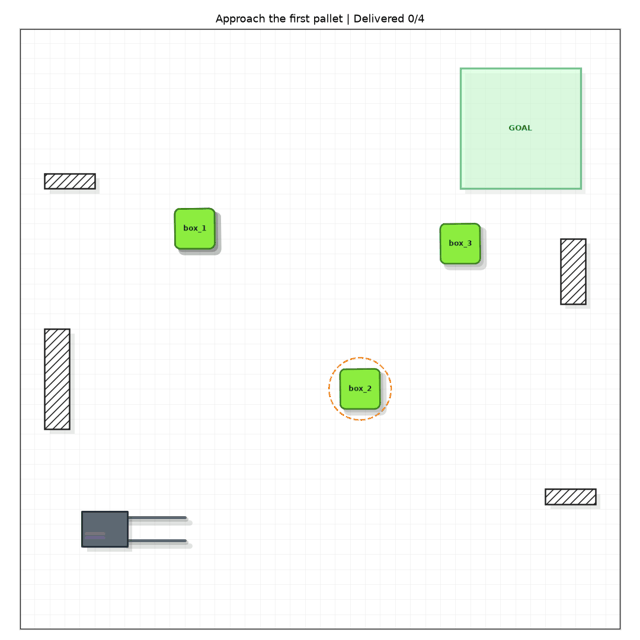
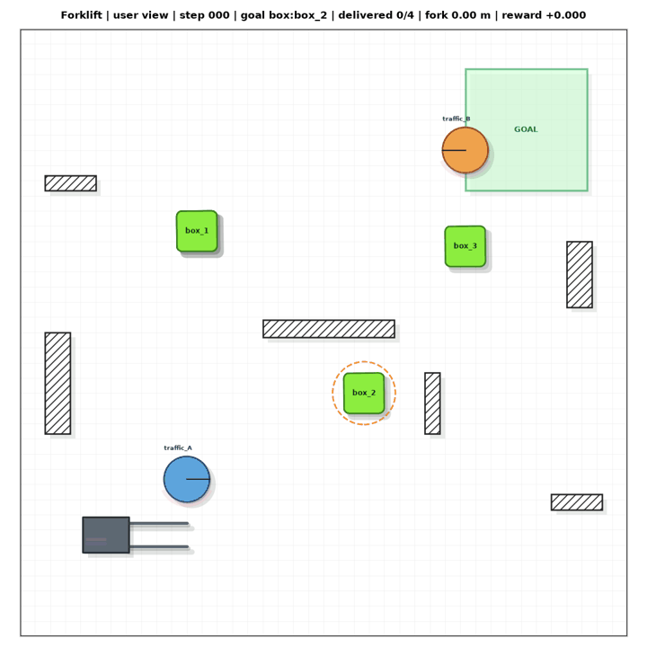
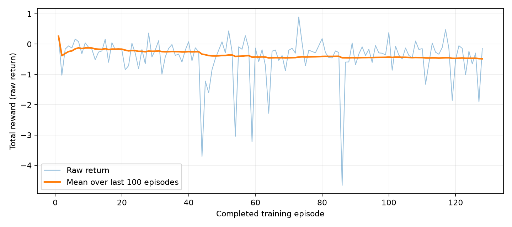

# ForkliftGym

A lightweight **Gymnasium forklift environment** for reinforcement-learning classes.
Drive, steer, lift pallets, carry them to a delivery area, and stack them. Includes
oriented pallets, source stacks, shelves, lidar, and optional moving robot traffic.



Scripted demonstration recorded from the simulator: approach, catch, lift, carry,
lower and stack all four default pallets, including both levels of the source stack.
Playback is accelerated 2x, with pauses at pickup and delivery. This illustrates the environment mechanics; it is not a trained PPO policy.

## Installation

Python 3.10+; Python 3.11 or 3.12 is a practical classroom choice. The simulator is
pure Python: **no C++ compiler, Box2D, SWIG, CUDA, or external simulator is needed**.
Initial dependency installation needs internet access.

Install directly from GitHub:

```sh
python -m pip install "forklift-gym @ git+https://github.com/luisgarrote/ForkliftGym.git"
```

For Stable-Baselines3 and the student examples:

```sh
python -m pip install "forklift-gym[sb3] @ git+https://github.com/luisgarrote/ForkliftGym.git"
```

Or clone to work with the example scripts and notebook:

```sh
git clone https://github.com/luisgarrote/ForkliftGym.git
cd ForkliftGym
python -m venv .venv
# macOS/Linux
source .venv/bin/activate
# Windows PowerShell: .venv\Scripts\Activate.ps1
python -m pip install --upgrade pip
python -m pip install -e ".[sb3]"
```

The repository is not yet published on PyPI; use the GitHub URL or a local checkout.

## First episode: native Gymnasium

```python
import gymnasium as gym
import forklift_gym  # registers the environment in this Python process

env = gym.make("Forklift-v0", render_mode="rgb_array")
obs, info = env.reset(seed=7)
env.action_space.seed(7)
print(obs.shape, env.action_space)  # (44,), Box(-1, 1, (3,), float32)
for step in range(700):
    action = env.action_space.sample()  # [drive, steer, lift]
    obs, reward, terminated, truncated, info = env.step(action)
    if terminated or truncated:
        break
env.close()
```

Render a seeded starting frame without installing SB3:

```sh
python examples/random_rollout.py --steps 0 --output outputs/forklift.png
python examples/random_rollout.py --steps 0 --traffic 2 --obstacles 2 --output outputs/traffic.png
```

## Moving agents and obstacles

```python
from forklift_gym import SB3ForkliftEnv

env = SB3ForkliftEnv(num_dynamic_agents=2, obstacle_count=2,
                     num_boxes=4, render_mode="rgb_array")
obs, info = env.reset(seed=7)
obs, reward, terminated, truncated, info = env.step([0.5, 0.0, 0.0])
env.close()
```

The name `SB3ForkliftEnv` indicates its single-agent interface; using this adapter
does not itself require SB3 to be installed. Scripted traffic continuously patrols
waypoints and is sensed by lidar. It collides with the body, fork tines and carried
loads. PPO controls only the forklift. `ForkliftTraffic-v0` is the equivalent
registered Gymnasium environment (two traffic agents by default). Traffic robots
within a scene are different from independent vectorized environment copies.



## Student workflow with Stable-Baselines3

The examples use SB3 directly: `PPO(...).learn(...)`, `model.save(...)` and
`PPO.load(...)`. Start with [examples/quickstart.ipynb](examples/quickstart.ipynb)
or the short [training script](examples/train_ppo.py). Run these commands from
the cloned repository after installing `.[sb3]`.

```sh
# 1. Train and save a model, configuration, episode log and reward graph.
python examples/train_ppo.py --steps 100000 --seed 0 --output outputs/ppo_seed0
# 2. Recreate the graph from the saved episode log at any time.
python examples/plot_rewards.py --log outputs/ppo_seed0/training.monitor.csv --output outputs/ppo_seed0/rewards.png
# 3. Load the saved model and run one fixed scenario.
python examples/run_model.py --run outputs/ppo_seed0 --case normal_1
# 4. Evaluate all ten fixed cases and retain every result, including failures.
python examples/evaluate.py --run outputs/ppo_seed0
# 5. Record one complete episode as MP4.
python examples/record_video.py --run outputs/ppo_seed0 --case normal_1 --output outputs/ppo_seed0/demo.mp4
```

The budget above is an example, not a promise of a successful policy. Each training
run needs a new output directory. Change `--seed` and `--output` for independent
training runs; report results across training seeds. The examples use one
`DummyVecEnv` environment and CPU execution to keep the code readable.

### Episode returns: raw and last 100 episodes

`Monitor` saves the **sum of rewards per completed episode**, before any reward
normalization, in `training.monitor.csv`. [plot_rewards.py](examples/plot_rewards.py)
uses Python's `csv` module, NumPy and Matplotlib; no pandas or dashboard is needed.
The essential calculation is:

```python
# rewards[i] is the total reward of episode i, in chronological order.
average = np.array([
    rewards[max(0, i - 99):i + 1].mean() for i in range(len(rewards))
])
plt.plot(rewards, alpha=0.45, label="Raw episode return")
plt.plot(average, label="Mean of last 100 episodes")
plt.xlabel("Completed episode")
plt.ylabel("Total reward")
plt.legend()
```

Before 100 episodes exist, the mean uses all available completed episodes.
`rewards.png` contains both curves; `rewards.csv` contains their numerical values (see the [example data](docs/example_rewards.csv)).
An unfinished final episode is not included. Training logs are separate from the
held-out evaluation results.



This example graph comes from a **2,048-transition integration check with a
16-step episode cap**, not a trained benchmark result. Use the normal episode
horizon for your experiments.

### Saved model, evaluation statistics and video

Keep `model.zip` and `config.json` together. The run/evaluation/video scripts
restore the same observation history. SB3 chooses deterministic actions for these
scripts. Training uses raw rewards and does not apply `VecNormalize`.

`evaluate.py` writes `evaluation.csv` and `evaluation.json` inside the run folder:
all ten episode returns, lengths, success and termination/truncation flags, plus
**mean return, population standard deviation and success rate for each group**.
Task-specific columns include contact steps and, for the forklift, pickup events,
delivery events and pallets delivered. CarRacing contact steps count the reported
static-obstacle collision flag only. Failed episodes are retained.

[record_video.py](examples/record_video.py) captures the initial frame and every
simulation step, including the final frame, without action/frame skipping. Frames
are streamed to MP4, with the longer side limited to 640 pixels. The accompanying
JSON records the case, return, success and frame rate. Video uses simulation time;
it does not affect policy observations. Video encoding dependencies are included
in `.[sb3]`.

`--max-steps 16` is available for quick integration checks in all scripts; it
changes the task horizon. Shortened evaluation files are named
`evaluation_short_16.*` and must not be reported as benchmark scores.

### Forklift training settings and fixed evaluation scenarios

Training defaults to the four-pallet warehouse, including a two-pallet source
stack. The policy is `MlpPolicy` with one 44-value observation. To sample pallet
layouts during training, add `--randomize`. To sample warehouses with traffic:

```sh
python examples/train_ppo.py --traffic 2 --obstacles 2 --steps 300000 --seed 0 --output outputs/traffic_seed0
python examples/run_model.py --run outputs/traffic_seed0 --case dynamic_1
python examples/record_video.py --run outputs/traffic_seed0 --case dynamic_2 --output outputs/traffic_seed0/dynamic.mp4
```

Optional `--history 4` stacks four observations; the saved configuration restores
this automatically. PPO, A2C, TD3 and DDPG accept the native continuous actions.
DQN needs an explicit discrete-action wrapper. The provided demo uses PPO; change
the algorithm and corresponding load calls for your assignment comparisons.

[evaluation_cases.json](examples/evaluation_cases.json) stores the complete map,
spawn, four pallets, stack levels, delivery rectangle and traffic initial states.
These are explicit scene files, not new random scenes sampled at evaluation time.
Each normal case has two static obstacles and a matching traffic version:

| Normal case | Traffic case | Reset seed | Moving agents | Step cap |
|---|---|---:|---:|---:|
| `normal_1` | `dynamic_1` | 20001 | 1 | 700 |
| `normal_2` | `dynamic_2` | 20002 | 2 | 700 |
| `normal_3` | `dynamic_3` | 20003 | 1 | 700 |
| `normal_4` | `dynamic_4` | 20004 | 2 | 700 |
| `normal_5` | `dynamic_5` | 20005 | 1 | 700 |

The five normal cases have no moving agents. Within each pair, geometry, pallets,
spawn and destination are identical; only scripted traffic is added. Controllers
continue moving and select new waypoints. Success means delivering all four
pallets. Use exactly these ten cases for every method, and keep them out of
training and hyperparameter selection. Create separate scenarios/seeds for
validation. Record the repository revision and case manifest with your results.

## Observation, action, reward and task

One observation is `float32`, shape `(44,)`:

| Indices | Features |
|---|---|
| 0–35 | 36 robot-frame lidar ranges, up to 5 m by default |
| 36–37 | Active goal displacement: forward and left, in metres |
| 38–39 | Linear and angular speed |
| 40 | Fork height |
| 41 | Carrying flag: 0 or 1 |
| 42 | Fraction of pallets still undelivered |
| 43 | Goal phase: box=0, delivery=1, complete=2 |


Actions are `[drive, steer, lift]`, each in `[-1, 1]`; default physical scales are
1.7 m/s, 2.8 rad/s and 1.5 m/s of fork motion. One action advances 0.08 s.
Low forks automatically engage a nearby accessible pallet; only the top pallet
of a source stack is accessible. A carried pallet stays attached until its whole
footprint fits in the delivery area (with the configured geometric tolerance)
and forks are low enough. A negative lift command lowers raised forks; release
itself depends on containment and height. The current task is a planar geometry
model, with simplified fork-height and stack logic, rather than rigid-body physics.

The active goal changes from the nearest accessible pallet to the delivery area
while carrying. After delivery it selects the next pallet. Goal switches reset
the progress baseline. Default reward is progress (1 per metre), minus time
(0.01), squared normalized control (0.001) and contact cost (0.35), plus pickup
(1), delivery (8) and final-completion (10) bonuses. Episodes terminate when all
pallets are delivered; the default time cap is 700 steps. Constructor parameters
allow changing these values. Info reports task events and delivered/remaining counts.

## Examples and custom scenarios

After cloning and installing:

```sh
python examples/random_rollout.py --output outputs/random.png
python examples/random_rollout.py --traffic 2 --obstacles 2 --output outputs/random_traffic.png
python examples/moving_agents.py --output outputs/traffic.gif
python examples/pallet_pickup.py --output outputs/pallet_pickup.gif
python examples/custom_scenario.py
python examples/train_ppo.py --steps 100000
```

`examples/quickstart.ipynb` contains an introductory notebook. A `Scenario` bundles
a `Map`, explicit pallets/stacks, a delivery rectangle and traffic specifications.
Use `scenario.to_dict()` for a JSON-friendly export and `load_scenario(payload)` to
load one. Six map presets are included as package data and work from an installed
wheel. Maps are geometry templates: custom forklift starts and routes should be
checked for both chassis and fork clearance.

For the parallel dictionary API, use `ForkliftParallelEnv`:

```python
from forklift_gym import ForkliftParallelEnv

env = ForkliftParallelEnv(num_dynamic_agents=2, obstacle_count=2, num_boxes=4)
observations, infos = env.reset(seed=7)
observations, rewards, terminated, truncated, infos = env.step({"main": [0, 0, 0]})
env.close()
```

`possible_agents` currently contains only `main`; background robots are scripted.
The 44-D observation does not expose privileged global traffic state. RGB images,
shadows and control widgets are visual diagnostics rather than the policy input.

## Development checks

```sh
python -m unittest discover -s tests -v
python -m pip wheel . --no-deps -w dist
```

The CI workflow tests environment contracts, deterministic resets, pickup/delivery,
stacking, oriented loads, traffic movement and installed-wheel resources. Its SB3
job checks direct training, checkpoint reload, reward plotting, all ten fixed
evaluation cases and MP4 recording. Short checks validate integration,
not policy quality. Source and environments are adapted from the course's
`mobile_robot_gym` forklift implementation.
