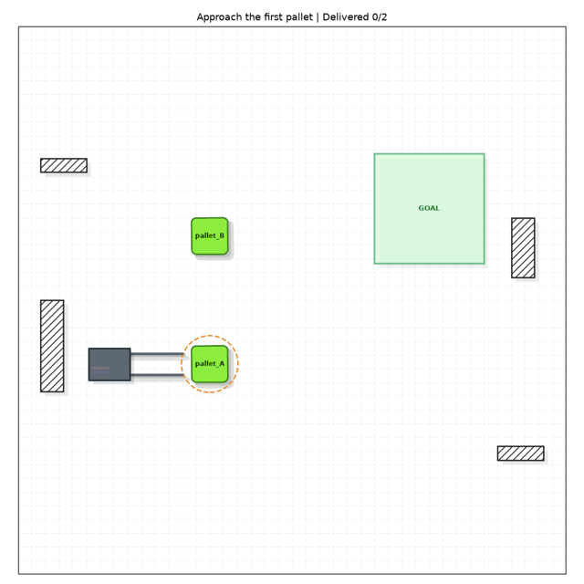
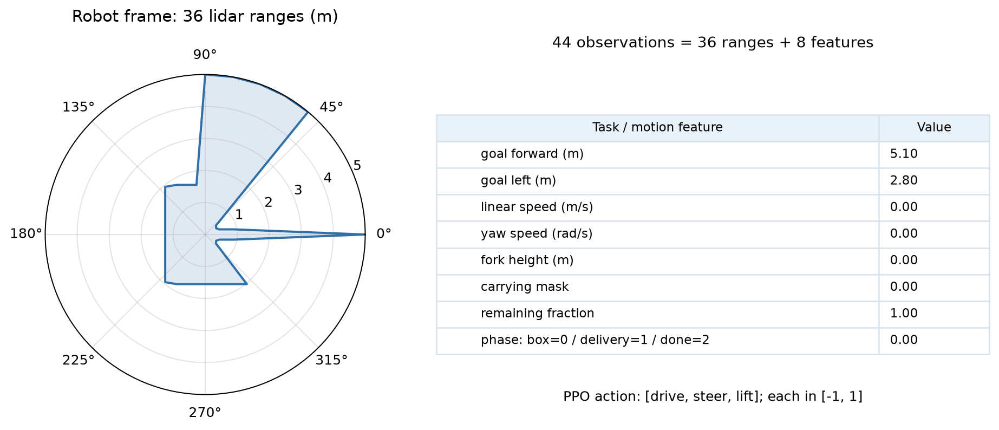

# ForkliftGym

A lightweight **Gymnasium forklift environment** for reinforcement-learning classes.
Drive, steer, lift pallets, carry them to a delivery area, and stack them. Includes
oriented pallets, source stacks, shelves, lidar, and optional moving robot traffic.



Scripted demonstration recorded from the simulator: approach, catch, lift, carry,
lower and stack two pallets. Playback is accelerated 2x, with pauses at pickup and
delivery. This illustrates the environment mechanics; it is not a trained PPO policy.

## Installation

Python 3.10+; Python 3.11 or 3.12 is a practical classroom choice. The simulator is
pure Python: **no C++ compiler, Box2D, SWIG, CUDA, or external simulator is needed**.
Initial dependency installation needs internet access.

Install directly from GitHub:

```sh
python -m pip install "forklift-gym @ git+https://github.com/luisgarrote/ForkliftGym.git"
```

For Stable-Baselines3 PPO and the training commands:

```sh
python -m pip install "forklift-gym[sb3] @ git+https://github.com/luisgarrote/ForkliftGym.git"
```

Or clone to work with the example scripts and notebook:

```sh
git clone https://github.com/luisgarrote/ForkliftGym.git
cd ForkliftGym
python -m venv .venv
# macOS/Linux
source .venv/bin/activate
# Windows PowerShell: .venv\Scripts\Activate.ps1
python -m pip install --upgrade pip
python -m pip install -e ".[sb3]"
```

The repository is not yet published on PyPI; use the GitHub URL or a local checkout.

## First episode: native Gymnasium

```python
import gymnasium as gym
import forklift_gym  # registers the environment in this Python process

env = gym.make("Forklift-v0", render_mode="rgb_array")
obs, info = env.reset(seed=7)
env.action_space.seed(7)
print(obs.shape, env.action_space)  # (44,), Box(-1, 1, (3,), float32)
for step in range(700):
    action = env.action_space.sample()  # [drive, steer, lift]
    obs, reward, terminated, truncated, info = env.step(action)
    if terminated or truncated:
        break
env.close()
```

Render a seeded starting frame without installing SB3:

```sh
forklift-lab frame --output outputs/forklift.png
forklift-lab frame --traffic 2 --obstacles 2 --output outputs/traffic.png
```

You can also use `python -m forklift_gym` wherever the guide uses `forklift-lab`.

## Moving agents and obstacles

```python
from forklift_gym import SB3ForkliftEnv

env = SB3ForkliftEnv(num_dynamic_agents=2, obstacle_count=2,
                     num_boxes=4, render_mode="rgb_array")
obs, info = env.reset(seed=7)
obs, reward, terminated, truncated, info = env.step([0.5, 0.0, 0.0])
env.close()
```

The name `SB3ForkliftEnv` indicates its single-agent interface; using this adapter
does not itself require SB3 to be installed. Scripted traffic continuously patrols
waypoints and is sensed by lidar. It collides with the body, fork tines and carried
loads. PPO controls only the forklift. `ForkliftTraffic-v0` is the equivalent
registered Gymnasium environment (two traffic agents by default). Traffic robots
within a scene are different from independent vectorized environment copies.


## Train PPO

```sh
forklift-lab train --steps 100000 --output outputs/fixed_seed0
forklift-lab train --randomize --num-boxes 4 --steps 100000 --output outputs/random_seed0
forklift-lab train --traffic 2 --obstacles 2 --steps 300000 --output outputs/traffic_seed0
```

Defaults: four vector environments, four-frame history (176 input values), an MLP
policy, observation/reward normalization and CPU execution. Fixed training uses
the four-pallet warehouse, including a two-pallet source stack. `--randomize`
samples pallet layouts; traffic/obstacle settings sample scenes on reset. Budgets
are starting points, not success guarantees. Each run needs a new output folder.

Saved artifacts:

- `model.zip`: PPO policy.
- `vecnormalize.pkl`: matching normalization statistics.
- `config.json`: seed, task settings, history, timestep count and package versions.
- `monitor/worker*.monitor.csv`: raw training episode returns and lengths.

Keep the model, statistics and configuration together. Defaults use sequential
`DummyVecEnv`. To run independent simulators in processes, add `--vec-env subproc`;
start with a small worker count and measure throughput on the available hardware.
For fair comparisons, count total transitions across all copies.

## Evaluate

```sh
forklift-lab evaluate --run outputs/traffic_seed0 --episodes 20 --seed 10000
```

Evaluation reloads scenario settings, history and normalization, freezes statistic
updates, and uses deterministic actions. It saves every episode's raw return,
success, steps, contact-step count, pickup/delivery events and number of pallets
delivered. It also reports success rate and mean return. Use the same held-out
scenario seeds across methods and retain failed episodes. Fixed scenes can reset
to identical states across seeds; use generated layouts to measure generalization.

## Direct SB3 usage

```python
from stable_baselines3 import PPO
from stable_baselines3.common.monitor import Monitor
from forklift_gym import ForkliftEnv

env = Monitor(ForkliftEnv())
model = PPO("MlpPolicy", env, verbose=1, device="cpu", seed=0)
model.learn(total_timesteps=100_000)
model.save("forklift_ppo")
env.close()
```

This minimal example uses SB3 defaults. The CLI adds normalization, history,
saved configuration and an evaluation pipeline. DQN needs an explicit discrete
action wrapper; PPO, A2C, TD3 and DDPG can consume the native continuous actions.

## Observation, action, reward and task

One observation is `float32`, shape `(44,)`:

| Indices | Features |
|---|---|
| 0–35 | 36 robot-frame lidar ranges, up to 5 m by default |
| 36–37 | Active goal displacement: forward and left, in metres |
| 38–39 | Linear and angular speed |
| 40 | Fork height |
| 41 | Carrying flag: 0 or 1 |
| 42 | Fraction of pallets still undelivered |
| 43 | Goal phase: box=0, delivery=1, complete=2 |



Actions are `[drive, steer, lift]`, each in `[-1, 1]`; default physical scales are
1.7 m/s, 2.8 rad/s and 1.5 m/s of fork motion. One action advances 0.08 s.
Low forks automatically engage a nearby accessible pallet; only the top pallet
of a source stack is accessible. A carried pallet stays attached until its whole
footprint fits in the delivery area (with the configured geometric tolerance)
and forks are low enough. A negative lift command lowers raised forks; release
itself depends on containment and height. The current task is a planar geometry
model, with simplified fork-height and stack logic, rather than rigid-body physics.

The active goal changes from the nearest accessible pallet to the delivery area
while carrying. After delivery it selects the next pallet. Goal switches reset
the progress baseline. Default reward is progress (1 per metre), minus time
(0.01), squared normalized control (0.001) and contact cost (0.35), plus pickup
(1), delivery (8) and final-completion (10) bonuses. Episodes terminate when all
pallets are delivered; the default time cap is 700 steps. Constructor parameters
allow changing these values. Info reports task events and delivered/remaining counts.

## Examples and custom scenarios

After cloning and installing:

```sh
python examples/random_rollout.py --output outputs/random.png
python examples/random_rollout.py --traffic 2 --obstacles 2 --output outputs/random_traffic.png
python examples/moving_agents.py --output outputs/traffic.gif
python examples/pallet_pickup.py --output outputs/pallet_pickup.gif
python examples/custom_scenario.py
python examples/train_ppo.py --steps 100000
```

`examples/quickstart.ipynb` contains an introductory notebook. A `Scenario` bundles
a `Map`, explicit pallets/stacks, a delivery rectangle and traffic specifications.
Use `scenario.to_dict()` for a JSON-friendly export and `load_scenario(payload)` to
load one. Six map presets are included as package data and work from an installed
wheel. Maps are geometry templates: custom forklift starts and routes should be
checked for both chassis and fork clearance.

For the parallel dictionary API, use `ForkliftParallelEnv`:

```python
from forklift_gym import ForkliftParallelEnv

env = ForkliftParallelEnv(num_dynamic_agents=2, obstacle_count=2, num_boxes=4)
observations, infos = env.reset(seed=7)
observations, rewards, terminated, truncated, infos = env.step({"main": [0, 0, 0]})
env.close()
```

`possible_agents` currently contains only `main`; background robots are scripted.
The 44-D observation does not expose privileged global traffic state. RGB images,
shadows and control widgets are visual diagnostics rather than the policy input.

## Development checks

```sh
python -m unittest discover -s tests -v
python -m pip wheel . --no-deps -w dist
```

The CI workflow tests environment contracts, deterministic resets, pickup/delivery,
stacking, oriented loads, traffic movement and installed-wheel resources. Its SB3
job checks short training and checkpoint reload. Short checks validate integration,
not policy quality. Source and environments are adapted from the course's
`mobile_robot_gym` forklift implementation.
